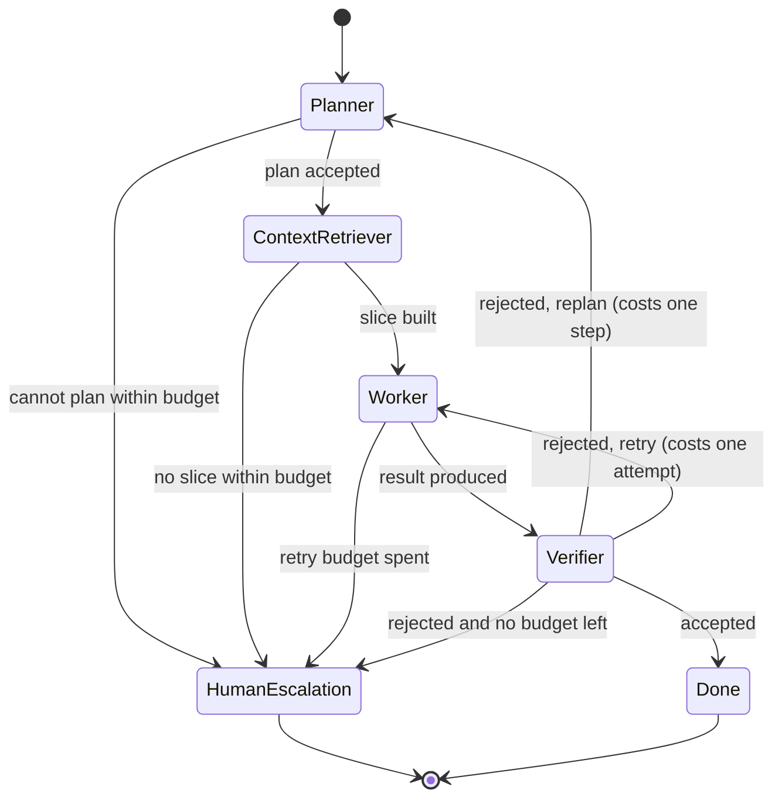

# The graph runtime — specification

**Companion to [ADR-0005](ADR-0005-the-graph-runtime.md), status Proposed,
2026-11-22.** Specifies the runtime ADR-0005 recommends building **beside** the
ReAct loop. **No code here**: types, invariants, and for every invariant the
test that must go red when it breaks and how to mutation-check that test.

**Nothing in this document is authorised to be built.** Phases 1–3 fit the
contract as amended 2026-11-22; phase 4 and the `hybrid` profile do not and are
gated.

## (a) The state graph

**Every edge is a transition, every transition writes one checkpoint, and every
transition decrements something.** There is no edge that costs nothing: a cycle
that does not spend budget is how a bounded machine becomes an unbounded one.

| node | reads | may call | never |
| --- | --- | --- | --- |
| `PlannerNode` | `goal`, the dependency graph's shape | the model | tools |
| `ContextRetrieverNode` | the dependency graph, `Workspace` | `read_file`, `list_directory`, `search_text`, `file_info` | the model |
| `WorkerNode` (phases 1–3) | `ast_context_slice` | the model, the six allowed tools **through the existing dispatcher** | write anything |
| `VerifierNode` | the worker's result, the slice | the model, read-only tools | accept its own output |
| `HumanEscalationNode` | everything in memory | nothing | continue by itself |

**Invariant G1 — the graph is a fixed, finite set of nodes and edges, declared
once.** No node is added at runtime, from configuration, or from model output.
*Red test:* `test_the_edge_set_is_frozen` — assert the transition table equals a
literal, and that a transition to a name not in it raises rather than being
created. *Mutation:* replace the membership check with `True`; the test must go
red on the specific unknown-node cause, not on "some error".

**Invariant G2 — the model never chooses the next node.** Transitions are
chosen by application code from a typed node result. *Red test:*
`test_model_output_cannot_name_the_next_node` — feed a fake model reply that
names `HumanEscalation` and `Done` in its text and assert the transition taken
is the one the result's status implies. *Mutation:* make the transition read the
reply text; the test goes red.

## (b) State, nodes, edges

### `AgentState`

| field | type | invariant | content-free? |
| --- | --- | --- | --- |
| `task_id` | `str` (opaque, generated) | never derived from user text or a path | **yes** |
| `goal` | `str` | the user's question; **in memory only** | no |
| `dependency_graph` | `DependencyGraph` | nodes are workspace-relative paths and symbol names; built once per run | no (paths) |
| `current_node` | `NodeId` enum | always a member of the frozen set (G1) | **yes** |
| `ast_context_slice` | `ContextSlice` | derived; never larger than `max_slice_bytes`; every file in it passed `Workspace.resolve` | no |
| `step_count` | `int` | `0 <= step_count <= max_steps`, monotonically increasing | **yes** |
| `max_steps` | `int` | `1 <= max_steps <= 50`, frozen at construction | **yes** |
| `tool_history` | `tuple[ToolCallRecord, ...]` | append-only; each record is name + sanitized status + digest, **not arguments or output** | **yes** |
| `verification_status` | enum `PENDING\|ACCEPTED\|REJECTED\|ESCALATED` | set only by `VerifierNode` | **yes** |
| `error_log` | `tuple[ErrorRecord, ...]` | each record is a category enum + node id + attempt number, **never a message, traceback or path** | **yes** |

**Why `tool_history` and `error_log` are content-free:** contract §5 forbids
persisting raw tool arguments, observations, errors and prompts, and `agent.py`
on `5005039` still embeds the full endpoint URL in two error strings (MEASURED
2026-11-22, `agent.py:770` and `:1220`) — which is exactly the mistake a record
that carries `str(exc)` repeats.

**Invariant S1 — `step_count` only increases, and only at a transition.** *Red
test:* `test_every_transition_spends_exactly_one_step`. *Mutation:* remove the
increment from one edge; the test goes red naming that edge.

**Invariant S2 — no field of `AgentState` that is written to a checkpoint
carries free text.** *Red test:* `test_checkpoint_fields_are_content_free` — a
run over a fixture whose file contents and question are distinctive strings;
assert none of those strings appears in any checkpoint byte. *Mutation:* add
`message=str(exc)` to `ErrorRecord`; the test goes red. **This is the canary the
contract's gate 4 asks for, applied to the new runtime.**

**Invariant S3 — `AgentState` is immutable; a transition returns a new one.**
*Red test:* `test_a_node_cannot_mutate_the_state_it_was_given` — pass a state,
assert the object the node received is unchanged by identity and value.
*Mutation:* make one node write through to the input; red.

### `GraphNode` and `GraphEdge`

| `GraphNode` | type | invariant |
| --- | --- | --- |
| `id` | `NodeId` | member of the frozen set |
| `allowed_tools` | `frozenset[str]` | **a subset of the fixed allowlist**, never a superset |
| `max_attempts` | `int` | `1 <= max_attempts <= 3` |

| `GraphEdge` | type | invariant |
| --- | --- | --- |
| `source`, `target` | `NodeId` | both frozen members |
| `condition` | enum | from a closed set of result statuses, never a predicate over model text |
| `cost` | `int` | `>= 1` |

**Invariant N1 — a node's `allowed_tools` is intersected with the fixed
allowlist at construction, not at call time.** *Red test:*
`test_a_node_cannot_widen_the_allowlist` — construct a node naming a tool
outside `FIXED_TOOL_ALLOWLIST` and assert construction fails. *Mutation:*
replace the intersection with the node's own set; red. **Mutation-check it
against brief 20's lesson: G enforces the allowlist in five places, and three
could be deleted with the suite green, so this test must name the constructor as
the refuser rather than asserting "refused".**

## (c) Checkpoints

- **One checkpoint per transition**, written **after** the node result is typed
  and **before** the next node runs.
- **Append-only JSONL**, one object per line, in a run-scoped directory outside
  the workspace and outside any logged path.
- **Content-free by default** (the §5 reason above). Fields: `task_id`,
  `sequence`, `from_node`, `to_node`, `step_count`, `verification_status`,
  `tool_history` length, `error_log` categories, `slice_sha256`,
  `protocol_sha256`, `duration_ms`.
- **Resume** = read the last line whose `verification_status` is `ACCEPTED`,
  restore `AgentState`'s content-free fields, and **rebuild everything else** —
  the slice from the AST, the goal from the user. A resume never restores text
  it did not write.
- **Retention and deletion are an open item for the SE**, and until they exist
  **the checkpoint directory defaults to a temporary location that is removed at
  process exit.** Contract §5: no persistent traces until a duration and a
  deletion path are defined.
- `--checkpoint-content` is specified and **inert**: it must refuse to run until
  the retention path exists.

**Invariant C1 — a transition without a checkpoint is impossible.** *Red test:*
`test_every_edge_taken_appends_exactly_one_line` — count lines against
transitions for a scripted run. *Mutation:* remove the write from one edge; red.

**Invariant C2 — resume never invents a step.** *Red test:*
`test_resume_from_the_last_accepted_node_does_not_rerun_it` — resume a canned
checkpoint file and assert `step_count` continues rather than restarts.
*Mutation:* resume from the last line instead of the last accepted one; red.

**Invariant C3 — the checkpoint file is append-only.** *Red test:*
`test_a_checkpoint_line_is_never_rewritten` — hash each line after writing, run
to completion, re-hash. *Mutation:* open the file in `w` mode; red.

## (d) The routing policy layer

One layer, two profiles, as ADR-0005 sets out.

| | `local-only` (default, shipped) | `hybrid` (specified, disabled) |
| --- | --- | --- |
| planner | local model | cloud model |
| worker / verifier | local model | local model |
| endpoint | loopback IP literal, validated | would need its own validator and egress policy |
| status | **enabled** | **refused at construction** |

**Invariant R1 — `hybrid` cannot be enabled by configuration.** The profile
resolves through the same endpoint validator; a non-loopback host raises
`EndpointPolicyError` before any client is built. *Red test:*
`test_hybrid_profile_is_refused_before_any_client_exists` — select `hybrid`,
assert the refusal and assert **no socket was opened** (the brief-14 pattern:
monkeypatch `socket.connect`, `create_connection` and the transport to raise, so
a refusal that arrived at connection time fails the test instead of passing it).
*Mutation:* remove the profile check; the test must go red on the validator's
specific cause, which also proves the validator — not the absent network — is
what refused.

**Invariant R2 — the routing decision is recorded as an enum, never as a URL.**
*Red test:* `test_no_checkpoint_or_log_line_contains_a_url`. *Mutation:* record
`base_url`; red. (See the two measured `agent.py` strings above for why.)

## (e) The AST context slice

Build a `DependencyGraph` over the workspace's Python files with the **stdlib
`ast`** module, then extract the smallest subgraph that reaches the goal's
anchor symbols.

| edge | how it is derived | how good it is |
| --- | --- | --- |
| `IMPORTS` | `ast.Import` / `ast.ImportFrom` | **exact** for static imports. Blind to `importlib`, `__import__`, conditional and function-local imports, and to anything re-exported through `__init__` |
| `CALLS` | `ast.Call` with a `Name` or `Attribute` func | **a name-based approximation.** It cannot resolve a method on a value whose type it does not know, a call through a variable, `getattr`, a decorator's wrapper, or dynamic dispatch. It will also join two unrelated functions that share a name |
| `MUTATES` | `ast.Assign` / `ast.AugAssign` / `ast.AnnAssign` targeting a module-level or attribute name | **the weakest.** It sees the shape of an assignment, not aliasing; a mutation through a reference is invisible |

**Say this in the product, not only here.** A slice is a *heuristic* context
budget, not a correctness guarantee. A node that assumes its slice is complete
is a node that will be wrong on dynamic code and will be confident about it.

- **Bound:** the slice is capped by `max_slice_bytes` **and** by node count; on
  overflow it drops the furthest-hop nodes first and **records that it
  truncated** — a silently truncated context is a wrong answer with no evidence.
- **Boundary:** every path in the graph is admitted by `Workspace.resolve`
  before it is read. The AST layer never opens a file itself.

**Invariant A1 — no file enters a slice without passing the workspace
boundary.** *Red test:* `test_a_dependency_edge_cannot_pull_a_file_outside_the
_workspace` — a fixture whose import points outside, and (on Windows) a junction
and a hard link, since those are the three link kinds this project has met.
*Mutation:* call `open()` directly in the AST layer; red. **This test is also
the regression test for the hard-link escape measured on `3c76fd2`** (MEASURED
2026-11-21: `read_file`, `file_info`, `list_directory` and `search_text` all
served a hard-linked outside file on O; G refuses all four).

**Invariant A2 — truncation is visible.** *Red test:*
`test_a_truncated_slice_sets_the_truncated_flag_and_the_count`. *Mutation:* drop
the flag; red.

**Invariant A3 — the graph is built once per run and is not rebuilt from model
output.** *Red test:* `test_the_dependency_graph_is_not_rebuilt_mid_run`.
*Mutation:* rebuild per node; red.

## (f) Tool contracts and the sandbox boundary

The graph runtime **adds no tool and no capability**. It calls the same six
tools through the same dispatcher, and the boundary is the one that already
exists on the canonical line (`5005039`):

- `Workspace.resolve` / `read_text` / `read_text_range` / `describe` /
  `list_dir`, with the hard-link guard, the hidden/credential/denied rules, the
  size and binary checks and the output caps;
- `validate_loopback_url` and `LoopbackOnlyTransport` for every model call;
- `FIXED_TOOL_ALLOWLIST` and `FIXED_INTERNAL_CAPABILITY_ALLOWLIST`, plus the
  per-task allowlist, **enforced at dispatch**.

**Invariant T1 — every tool call made by any node goes through the existing
dispatcher.** No node calls a tool function directly. *Red test:*
`test_no_node_bypasses_the_dispatcher` — patch the dispatcher to record, run
every node against a fake model that asks for each tool, assert the recorder saw
them all. *Mutation:* have one node import and call `read_file` directly; red.

**Invariant T2 — a disallowed tool stops the run at that node; it is not
retried and no other tool is substituted.** *Red test:*
`test_a_disallowed_tool_escalates_instead_of_retrying`. *Mutation:* turn the
stop into a `continue`; red.

**A warning the implementing engineer must act on, carried from brief 20
(REPORTED by the PM 2026-11-22, decisive row MEASURED by me the same day):** the
allowlist is enforced in **five** places on `5005039`, and **three of them can
be deleted with the whole suite still green**; removing both per-task guards
leaves exactly one red test. **Do not add a sixth overlapping guard in the graph
runtime.** Call the existing one, and let brief 20 give each guard its own
mutation-anchored test first.

## What this specification does not settle

- **Retention and deletion for checkpoints** — the SE's, and the thing that
  keeps `--checkpoint-content` inert.
- **The verifier's acceptance rules** — AI/ML's, contract §3 territory. A
  verifier that marks its own worker's output accepted on a substring is the
  same mistake as a comparison question graded on a filename.
- **Whether slices are smaller than today's context budget.** Unmeasured.
- **Where the package lives** — ADR-0002's package move decides it.
- **Anything about phase 4 or `hybrid`.** Gated, and deliberately unspecified
  beyond their refusals.
